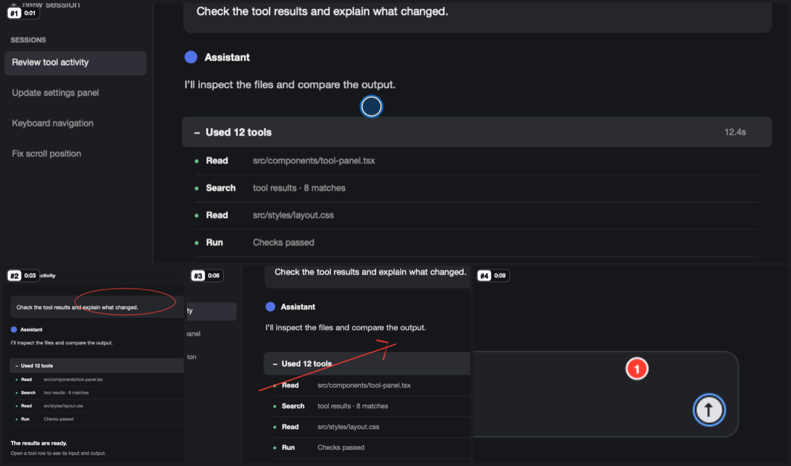
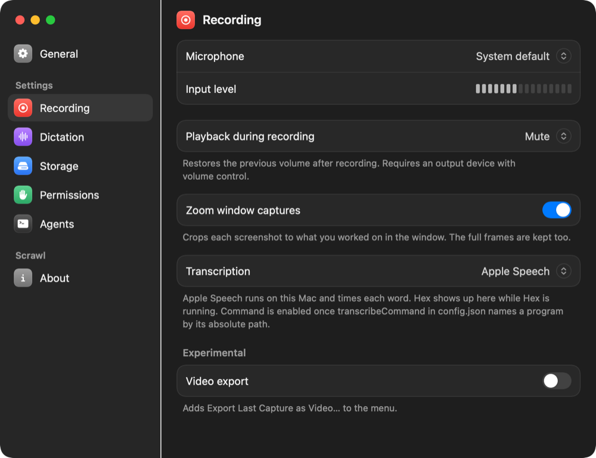
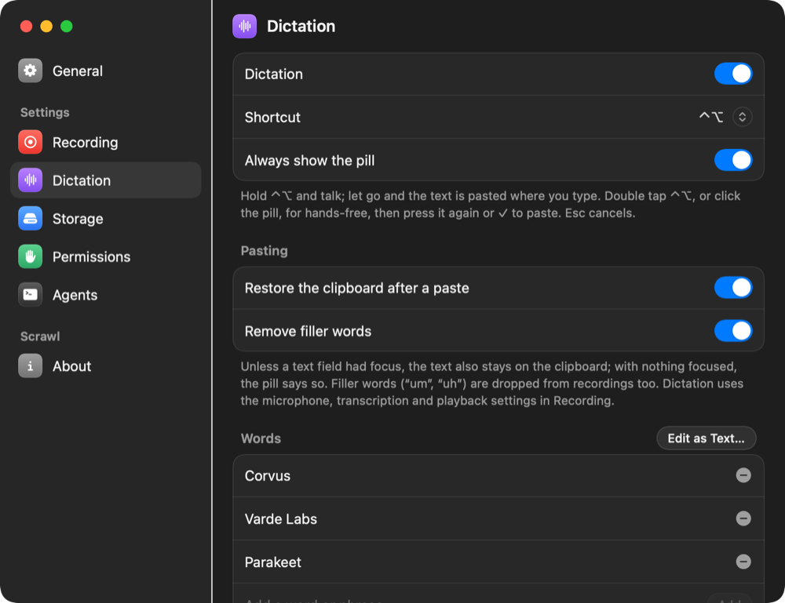
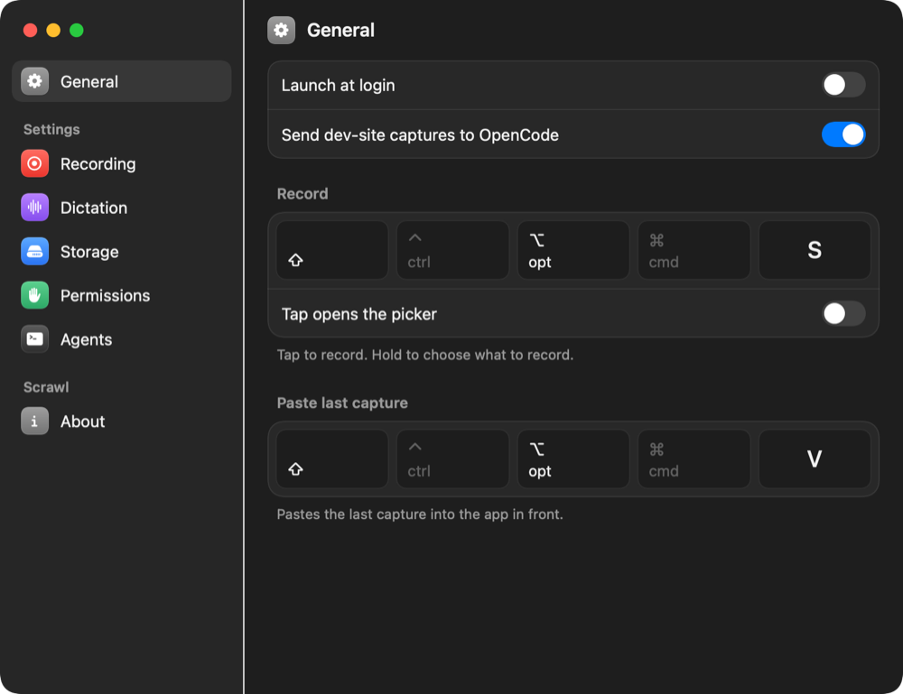

# Scrawl for macOS 15

A fork of [Kit Langton's Scrawl](https://github.com/kitlangton/scrawl) that builds and runs on
macOS 15 Sequoia, with local transcription and a set of workflow changes on top. Scrawl lets you
show an agent a problem instead of describing it: press a shortcut, talk, click and draw, and it
packs the screen, your voice and your marks into a bundle an agent can read.

**For what Scrawl is and how it works, read [Kit's README](https://github.com/kitlangton/scrawl#readme).**
This page covers only what the fork adds. The full reference, with the fork's additions folded in,
is in [`docs/guide.md`](docs/guide.md).



## What the fork adds

- **Runs on macOS 15.** Kit's build needs macOS 26 for transcription. This one transcribes
  locally with [Parakeet](https://github.com/senstella/parakeet-mlx) through
  `scripts/scrawl-parakeet.py`, and starts the model as the recording begins, so a transcript is
  ready about a second after you stop.
- **Dictation.** Hold `⌃⌥` and talk, and the text is pasted where you type; double tap for
  hands-free. A dictionary of words and replacements, filler words ("um", "uh") removed, and
  spoken filenames written as `` `README.md` ``.
- **One keyframe per drawing.** Each mark you talk through gets its own screenshot and its own words.
- **Zoom on window captures.** Keyframes of a large window crop to what you worked on, as
  full-screen captures already did.
- **Playback ducking.** Music mutes (or lowers) while you record and fades back after.
- **Picker and shortcut changes.** A tap of the record shortcut can open the picker, Esc cancels a
  recording, and the window picker picks the window in front, including Scrawl's own Settings.
- **Stable local signing.** Rebuilds keep their Screen Recording and Microphone permissions.

| Recording | Dictation | General |
| --- | --- | --- |
|  |  |  |

## Build and install

There are no prebuilt releases of the fork. You need an Apple silicon Mac, Xcode 26 or later (for
the macOS 26 SDK; the app itself targets macOS 15), its Metal toolchain, and Rust.

```bash
xcodebuild -downloadComponent MetalToolchain
```

```bash
./scripts/create-local-signing.sh
```

```bash
./scripts/install-app.sh
```

`create-local-signing.sh` makes a self-signed "Scrawl Local Signing" identity in your login
keychain, once. `install-app.sh` builds Scrawl, signs it with that identity and installs it as
`~/Applications/Scrawl.app`.

For transcription on macOS 15, install Parakeet and point Scrawl at it, as
[`docs/guide.md`](docs/guide.md#your-own-model-command) describes:

```bash
uv tool install parakeet-mlx
```

## Staying in sync with Kit

`main` mirrors `kitlangton/scrawl`; `macos-15` is the fork's default branch. Kit's changes are
merged into `macos-15` as their own pull requests. Kit's README lives on as `docs/guide.md`, so git
carries his README edits into the guide when they merge.

## License

MIT, as Kit's original. See [LICENSE](LICENSE).

### THIRD_PARTY

`helper/PermissionPanel.swift` adapts code and tuning from two MIT-licensed projects:

- [AskForPermission](https://github.com/riko2chen/AskForPermission), Copyright (c) 2026 Riko: the
  flight along a quadratic Bézier, waiting for the System Settings window to settle, following it
  through the window server, and the race that resolves a drop.
- [PermissionFlow](https://github.com/jaywcjlove/PermissionFlow), Copyright (c) 2026 小弟调调: the
  Privacy pane deep links and macOS 27's "Device Control and Data Access" name for Accessibility.

Both are under the MIT License: permission is hereby granted, free of charge, to any person
obtaining a copy of this software and associated documentation files (the "Software"), to deal in
the Software without restriction, including without limitation the rights to use, copy, modify,
merge, publish, distribute, sublicense, and/or sell copies of the Software, and to permit persons to
whom the Software is furnished to do so, subject to the following conditions: The above copyright
notice and this permission notice shall be included in all copies or substantial portions of the
Software. THE SOFTWARE IS PROVIDED "AS IS", WITHOUT WARRANTY OF ANY KIND, EXPRESS OR IMPLIED,
INCLUDING BUT NOT LIMITED TO THE WARRANTIES OF MERCHANTABILITY, FITNESS FOR A PARTICULAR PURPOSE AND
NONINFRINGEMENT. IN NO EVENT SHALL THE AUTHORS OR COPYRIGHT HOLDERS BE LIABLE FOR ANY CLAIM, DAMAGES
OR OTHER LIABILITY, WHETHER IN AN ACTION OF CONTRACT, TORT OR OTHERWISE, ARISING FROM, OUT OF OR IN
CONNECTION WITH THE SOFTWARE OR THE USE OR OTHER DEALINGS IN THE SOFTWARE.
